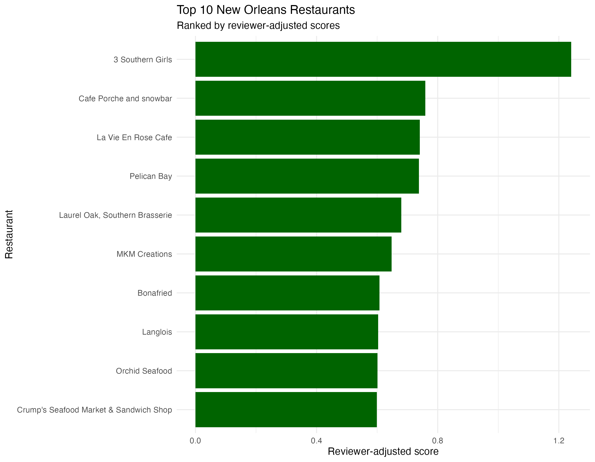
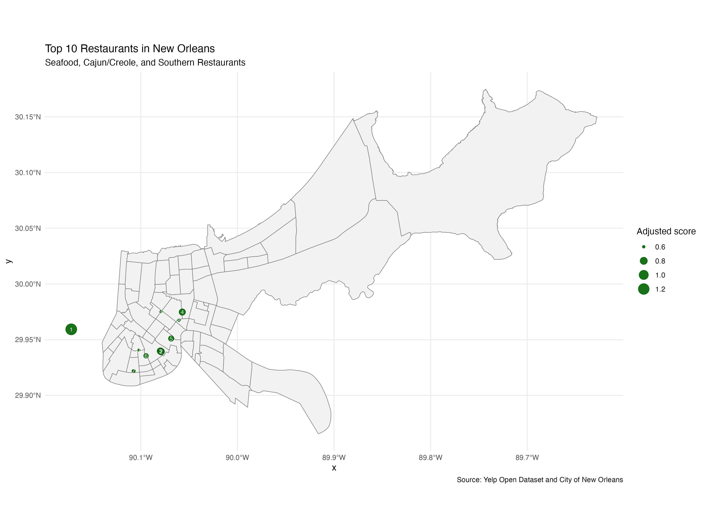
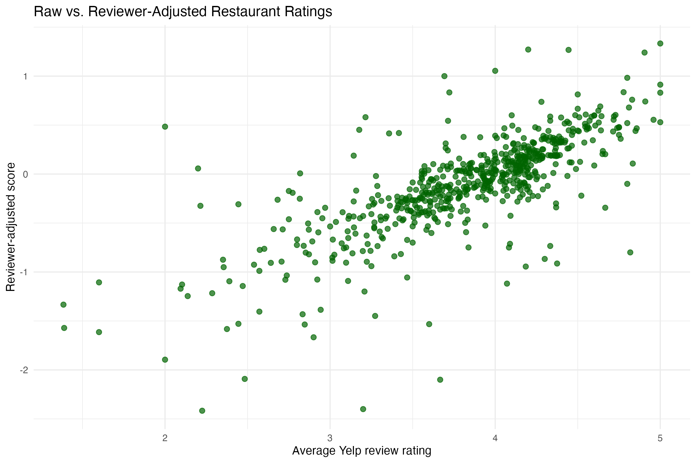

<<<<<<< HEAD
# MATH167R-Project2

## Geographic Analysis
  I compared 2 Geographic systems for analyzing restaurant distribution: NSA and 2020.

### Geographic Comparison Table
See [geography_comparison.csv](output/geography_comparison.csv).

### NSA: Restaurant Distribution

### NSA: Average Ratings

### Census Tract: Restaurant Distribution

### Source Code
[View Steps 3-6 Analysis](R/step3_to_step6.R)
=======
# Yelp New Orleans Restaurant Analysis

## Project Overview
The goal of this project is to analyze the Yelp reviews and restaurant data from New Orleands, Louisiana.
I intended to investigate the restaurant categories, geographic patterns, and customer ratings to understand the local restaurants.
The analysis uses Yelp business and review data and geographic boundary data, in order to analyze restuarants from the different areas of New Orleans.

## Research Question
How do restaurant categories, geographic location, and reviewer-adjusted ratings relate to the distribution and performance of restaurants in New Orleans?

## Data Sources
- Yelp Academic Dataset: business and review JSON files
- New Orleans neighborhood statistical area boundaries
- U.S Census tract boundaries

## Restaurant Categories

The selected restaurant categories included:
- Seafood
- Cajun/Creole
- Southern

A restaurant was included in the analysis if it has at least one of these selected categories.

**Number of Restaurants:** 648
**Number of Geographic Areas:** 10

## Geographic Analysis

This project compares two geographic systems:
1. New Orleans Neighborhood Statistical Areas.
2. U.S. Census Tracts

Restaurants are assigned to geographic areas using spacial joins. 
The analysis compares restaurants, their counts, and average ratings across the two geographic systems.

### Geographic Visualizations

## Reviewer-Adjusted Ratings

The project compares a restaurant's average Yelp ratings with adjustments.
Reviewer adjusted ratings account for whether a reviewer gives a higher or lower rating than other reviewers.

## Top 10 Restaurants

The project identifies the top 10 restaurants using reviewer-adjusted ratings.
The criteria to determine the top 10 focused on the highest raw average rating. 

## Additional Visualizations

## Tools and Packages: 
- R
- tidyverse
- jsonlite
- data.table
- tigris
- sf
- janitor
- ggplot2

## How to Reproduce the Analysis

1. Clone/download this repository.
2. Open the "Project2.Rproj" file in RStudio.
3. Install the required R packages, have the Yelp Academic Dataset, and required JSON files downloaded.
4. Run the R scripts in the "R/"" folder in the appropriate order.
5. The scripts generate the filtered datasets, summary tables, and visualizations.

NOTE: The original raw Yelp JSON files are not included in the repository because of their size.

## Limitations

- The analysis only includes restaurants located in New Orleans, Lousiana.
- Only restaurants matching on of the selected categories are included in the analysis.
- Yelp reviews represent the opinions of Yelp users and do not represent all customers.
- Geographic results will differe depending on the boundary system used.

## Conclusion

I found that the best ranking restaurant in New Orleans is the 3 Southern Girls.
This restaurant had a rating of 4.9, with a 1.24 reviewer adjustment rate.
>>>>>>> 64e2906 (Adding more files)
