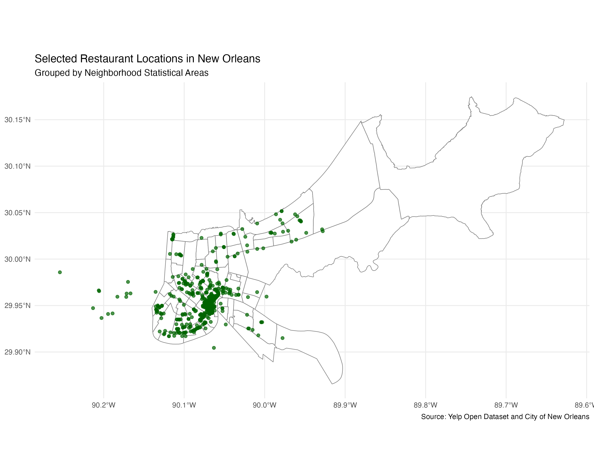
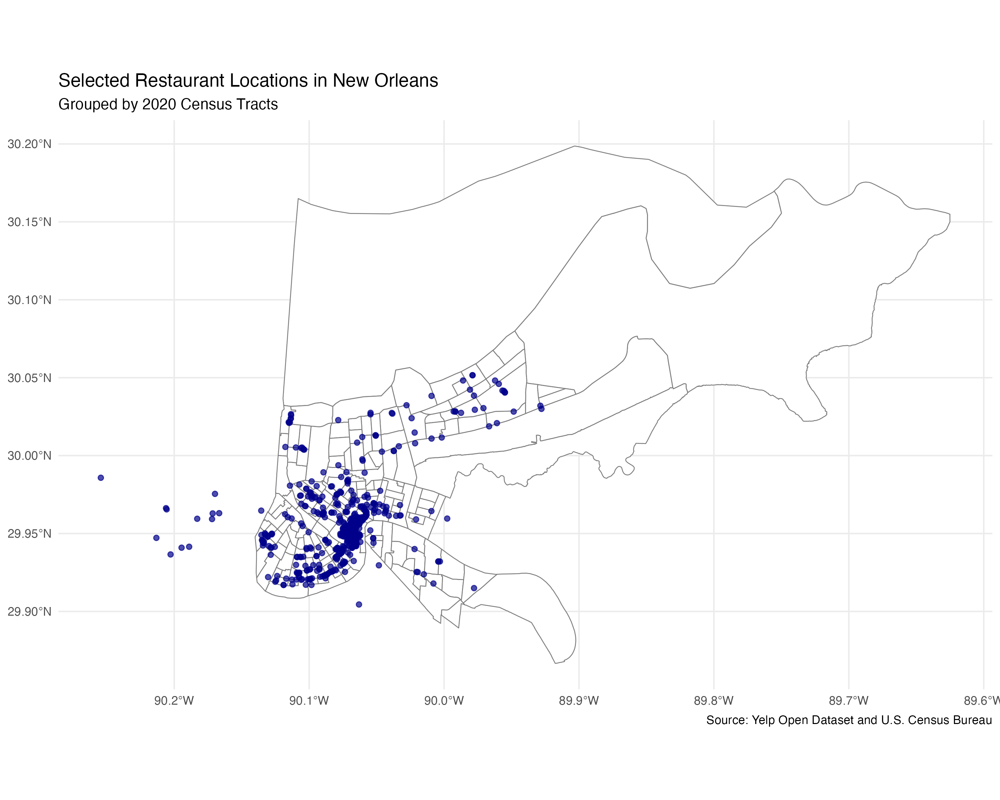
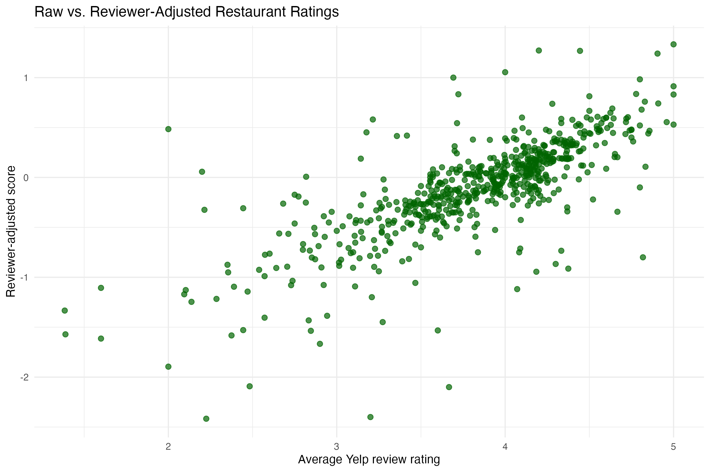
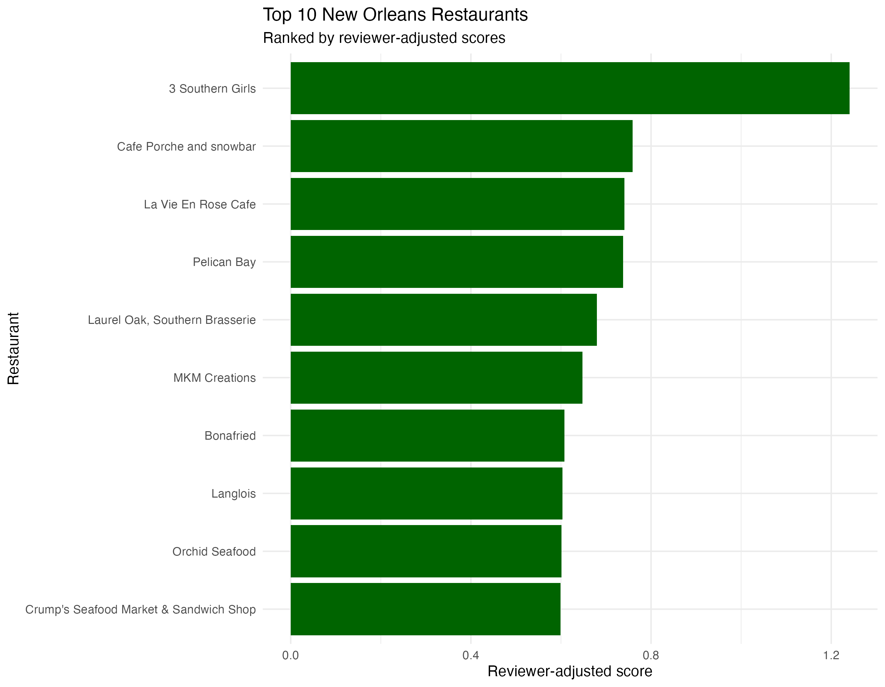
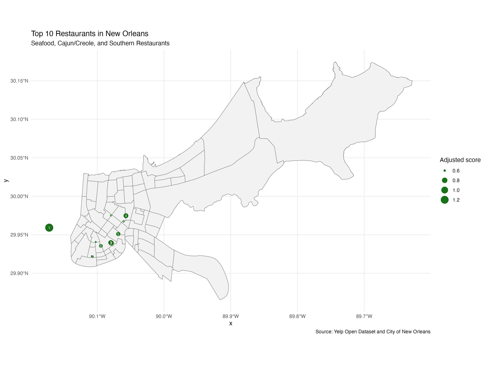

## Project Overview

### Research Question

This project investigates the restaurant landscape of New Orleans using Yelp business information, customer reviews, and geographic data.

The analysis focuses on three main questions:

1.  How are seafood, Cajun/Creole, and Southern restaurants distributed throughout New Orleans?

2.  Which geographic areas contain the strongest concentration of restaurants in these categories?

3.  Do restaurant rankings change when individual reviewer scoring tendencies are considered?

The project combines restaurant category analysis, spatial analysis, and reviewer-adjusted ratings to provide a more detailed comparison of restaurant options.

### Summary

This project analyzes Yelp restaurants businesses and reviews in New Orleans, Louisiana. It focused on Seafood, Cajun/Creole, and Southern. With the data filtered, I used it to investigate differences in restaurant ratings and geographic distribution.

The analysis compares Neighborhood Statistical Areas and Census tracts and examines whether restaurant rankings changed when individual reviews are considered.

### Main Findings

1.  **Finding 1**

    **First Ranked Restaurant: 3 Southern Girls**

    - Raw Average Rating: 4.9

    - Adjusted Average Rating: 1.24

    **Observation**: La Vie En Rose Cafe has a higher average rating (4.91) but ranks third because of the rating adjustment (1.24).

    **Conclusion**: This shows that raw ratings and reviewer-adjusted scores measure different things. Reviewer adjustment accounts for how generous or critical reviewers tend to be.

2.  **Finding 2**

    High raw ratings do not guarantee a high adjusted ranking.

    **Observation**: Pelican Bay has a lower average rating (4.28) than compared to La Vie En Rose Cafe (4.91). However, their adjusted scores differ. The score for Pelican Bay (0.738) is much lower than La Vie En Rose Cafe (0.741).

    **Conclusion**: This suggests that scoring habits can change how restaurants are ranked.

3.  **Finding 3**

    **Observation**: The top 10 restaurants all have positive adjusted scores. This means that the reviewers rated these restaurants above their own usual rating baselines on average.

    **Conclusion**: This is interesting because it suggests that these restaurants received relatively favorable evaluations, even after accounting for reviewer tendencies.

## Data Sources and Preparation

### Data Sources

The analysis uses

- Yelp business dataset

- Yelp review dataset

- New Orleans Neighborhood Statistical Area boundaries

- U.S Census tract boundaries

The business and review datasets are connected through 'business_id'. Each restaurant can have multiple reviews.

### Large-Data Management

The Yelp dataset contains large JSON files, which requires a sufficient amount of storage.

**How I Handled the Data**

1.  The downloadable Yelp JSON files can be found in data/raw. The processed datasets for my analysis can be found in data/new_orleans.
2.  I used jsonlite::stream_in() to read the JSON data into R, which was then assigned to a variable.
3.  In order to filter the data, I used filter(), assigning the city as New Orleans, state as Louisiana, narrowed down to only Restaurants. Then I saved the smaller dataset (new_orleans_business.rds).
4.  I then processed the reviews by using the specific business id, which kept reviews belonging to those businesses.

**Note**: The original raw JSON files are not included in GitHub because of their size.

### **Data Cleaning + Preparation Process**

Note: Download process can be found in the README.md.

Missing coordinates affect spatial analysis because restaurants cannot be assigned to geographic boundaries without usable locations.

Duplicate business records were checked for by using business_id to avoid counting the same restaurant multiple times.

Reviews were matched to restaurants through their business identifiers.

## Restaurant Category Analysis

### Selected Categories

The analysis focused on three different categories: Seafood, Cajun/Creole, and Southern

These categories were selected were selected because they represent restaurant types relevant to New Orleans and provide a focused way to compare local dining options.

A restaurant was included if it belonged to at least one of the three selected.

Businesses belong to more than one category, which means that the count and overlaps should be interpreted with the possibility of that in mind.

```{r}
category_counts <- read.csv("output/selected_category_counts.csv")

knitr::kable(
  category_counts,
  caption = "Number of Restaurants in Each Selected Category"
)
```

### Category Counts and Co-Occurrence

**Category Counts**

The following table summarizes the number of restaurants represented in each selected category.

**Category Distribution**

The following compares the representation of the three selected categories.

**Category Overlap**

A restaurant can belong to more than one selected category. The analysis groups business by their number of selected categories to determine how frequently multiple classifications occur. For example, a restaurant might serve both seafood and traditional Creole dishes.

This means the categories describe overlapping restaurant types rather than completely separate groups.

```{r}
category_overlap <- read.csv("output/category_overlap.csv")

knitr::kable(
  category_overlap,
  caption = "Overlap Between Selected Restaurant Categories"
)
```

**Category Combinations**

The table below provides additional detail about which pairs of categories commonly appear together. It helps show how the selected cuisines overlap in the Yelp business listings.

```{r}
category_pairs <- read.csv("output/category_overlap.csv")

knitr::kable(
  category_pairs,
  caption = "Restaurants Sharing Multiple Selected Categories"
)
```

## Restaurant Reviews

After selecting the restaurants, Yelp reviews were connected to each business. This allowed the analysis to examine customer ratings and review activity.

The review summary includes the number of reviews and the average review rating for each restaurant.

```{r}
review_summary <- read.csv("output/review_summary.csv")

knitr::kable(
  head(review_summary, 10),
  caption = "Sample of Restaurant Review Summaries"
)
```

The review data provides a way to compare customer experiences across restaurants. However, average ratings alone do not account for differences in how individual reviewers use Yelp's rating system. For example, some reviewers may regularly give high ratings, while others are more critical.

## Geographic Analysis

This part examines where selected restaurants are located in New Orleans. Two geographic systems were used: Neighborhood Statistical Areas (NSA) based in the city of New Orleans, and 2020 Census tracts based on US Census Bureau boundaries.

### Restaurant Locations by Neighborhood

The map shows the locations of selected restaurants in relation to New Orleans NSA.

The distribution helps identify neighborhoods with clusters of selected restaurants and areas with fewer restaurants.



### Restaurant Locations by Census Tract

This map displays the same restaurant locations using 2020 Census tract boundaries.

Comparing the two maps shows how the choice of geographic boundaries changes the way restaurant distribution is represented.



### Geographic Comparison

The table below compares the geographic coverage of the two systems. It includes the number of geographic areas, occupied areas, assigned restaurants, unmatched restaurants, and the smallest and largest restaurant counts per area.

The comparison helps determine how the two geographic systems represent restaurant distribution. The number of restaurants assigned the number of unmatched restaurants are especially useful when evaluated how well boundary system covers the selected business.

```{r}
geography_comparison <- read.csv("output/geography_comparison.csv")

knitr::kable(
  geography_comparison,
  caption = "Comparison of Neighborhood Statistical Areas and Census Tracts"
)
```

## Reviewer-Adjusted Ratings

A limitation of regular Yelp ratings is that reviewers have different rating habits. Some reviewers may consistently give higher ratings, while others may give lower ratings.

To account for this, the analysis calculates each reviewers average rating and compares individual reviews against that average.

Only reviewers with at least five selected restaurant reviews were included in the adjusted rating calculation.

The adjusted score is calculated as:

(Adjusted Score = Restaurant Review Rating - Reviewer's Average Rating)

A positive score means the reviewer rated the restaurant above their personal average. A negative score means the reviewer rated it below their personal average.

Restaurant adjusted ratings are calculated by averaging these normalized review scores.

### Reviewer Activity

The reviewer activity data shows how many selected restaurant reviews each user contributed. The 5-review threshold helps reduce the influence of reviewers with very little activity. However it also means that some reviews are excluded from the adjusted-rating calculation.

```{r}
reviewer_activity <- read.csv("output/reviewer_activity.csv")

knitr::kable(
  head(reviewer_activity, 10),
  caption = "Sample of Reviewer Activity"
)
```

### Comparing Raw and Adjusted Ratings

This figure compares regular average Yelp ratings with reviewer-adjusted restaurant scores. The comparison helps show whether restaurants receive different evaluations after accounting for reviewer behavior. Restaurants may move up or down in the rankings depending on the reviewer-adjusted restaurant scores.

The graph seems to imply that as the reviews increase, the reviewer-adjusted score also increases. This implies that restaurants with higher reviews tend to have more adjusted scores, suggesting that they receive more positive feedback relative to their reviewers' typical rating behavior. Keep in mind this does not imply causation.

The adjusted score should be interpreted as a relative measure of reviewer feedback, but not a replacement for the original Yelp star rating.



## Top 10 Restaurants

The final ranking identifies the 10 restaurants with the highest reviewer-adjusted scores. To qualify for the ranking, a restaurant needed at least five eligible reviews from reviewers who met the five-review activity threshold.

The table below includes each restaurants original average rating, adjusted score, total number of reviews, and number of eligible reviews.

The original and adjusted ratings provide two different ways to evaluate restaurant performance. The adjusted ranking emphasizes how reviewers rated a restaurant relative to their usual rating behavior.

```{r}
top_10 <- read.csv("output/top_10_restaurants.csv")

knitr::kable(
  top_10[, c(
    "final_rank",
    "name",
    "city",
    "raw_average_rating",
    "adjusted_average_rating",
    "total_reviews",
    "eligible_review_count"
  )],
  digits = 2,
  caption = "Top 10 Restaurants Ranked by Reviewer-Adjusted Scores"
)
```

### Top 10 Restaurant Ratings

The figure below presents the ten highest-ranked restaurants based on the reviewer-adjusted scores.

Restaurants with higher adjusted scores received ratings that were more positive relative to their reviewers' personal averages.



### Top 10 Restaurant Locations

This map below shows where the top ten restaurants are located within New Orleans Neighborhood Statistical Areas.

The map connects the ranking results to the geographic analysis and shows whether the highest-ranked restaurants are concentrated in particular areas.



## 8. Conclusion

\
This project examined Seafood, Cajun/Creole, and Southern restaurants in New Orleans using Yelp business and review data.

The category analysis showed how the selected cuisines are represented in Yelp listings how frequently restaurants belong to multiple categories.

The geographic analysis compared restaurant distribution using NSA and 2020 Census tracts. Using both systems provides two different perspectives on where restaurants are located and how they are distributed across the city.

The reviewer-adjusted analysis provided another way to evaluate restaurant ratings. Instead of relying only on average Yelp stars, it considered each reviewer's typical rating behavior. This allowed the final restaurant ranking to reflect ratings relative to individual reviewer averages.

Overall, combining category information, geographic analysis, and reviewer-adjusted ratings provides a broader understanding of the selected restaurant groups in New Orleans.

## Limitations

There are several limitations to this analysis:

- Restaurant categories depend on how businesses are labeled on Yelp.

- Some restaurants belong to multiple selected categories.

- The top ten ranking requires at least five eligible reviews per restaurant, which excludes businesses with insufficient eligible review activity.

- Reviewer-adjusted scores measure ratings relative to each reviewer's average, not overall restaurant quality.

These limitations should be considered when interpreting the results.

## Sources

- Yelp Open Dataset: <https://business.yelp.com/data/resources/open-dataset/>

- City of New Orleans GIS Data: <https://gis.nola.gov/>

- U.S. Census Bureau: <https://www.census.gov/>
